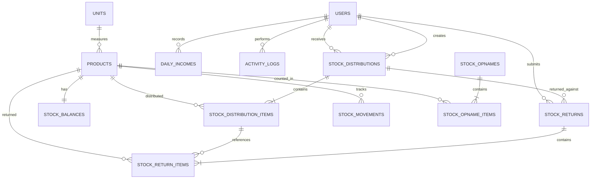
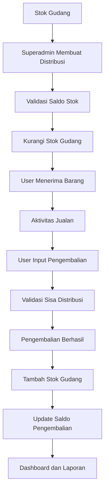

# Sistem Inventory Gudang dan Pendapatan Harian

## 1. Ringkasan

Aplikasi ini digunakan untuk mencatat dan memantau stok gudang,
distribusi barang kepada user untuk kegiatan jualan, pengembalian sisa
barang ke gudang, serta pendapatan harian.

Fokus sistem:

- Superadmin mengelola master user, barang, dan satuan.
- Superadmin mengelola stok, stock opname, dan distribusi barang.
- User hanya mencatat pengembalian sisa barang dan pendapatan harian.
- Stok gudang dihitung berdasarkan riwayat pergerakan barang.
- Hasil stock opname digunakan untuk membandingkan stok sistem dengan stok fisik dan menjadi dasar penyesuaian stok setelah diposting.
- Pendapatan dicatat manual dan tidak otomatis mengubah stok.

Dokumen ini menjelaskan kebutuhan bisnis, aturan operasional, struktur
data, relasi, alur, hak akses, dan kebutuhan laporan. Pemilihan
teknologi dan tech stack ditentukan secara terpisah.

## 2. Ruang Lingkup dan Asumsi

- Sistem hanya memiliki satu gudang.
- Terdapat dua role: `superadmin` dan `user`.
- Distribusi barang dapat dilakukan kapan saja (fleksibel).
- Distribusi barang dibuat oleh superadmin dan diberikan kepada user
  tertentu.
- User hanya dapat menginput pengembalian barang yang sebelumnya
  didistribusikan kepadanya.
- Pengembalian langsung menambah stok gudang tanpa proses persetujuan.
- Pendapatan dicatat manual, satu rekap per user per tanggal.
- Sistem tidak mencatat detail transaksi penjualan kepada pelanggan.
- Selisih antara barang distribusi dan barang kembali hanya dapat
  dianggap sebagai estimasi barang terjual apabila tidak ada barang
  rusak, hilang, atau penggunaan lain.
- Stock opname dilakukan oleh superadmin untuk membandingkan saldo
  stok sistem dengan hasil penghitungan fisik di gudang.
- Selama sesi stock opname aktif, transaksi yang mengubah stok gudang
  dihentikan sementara agar hasil penghitungan dan penyesuaian akurat.

## 3. Role dan Hak Akses

### 3.1 Superadmin

Superadmin dapat:

- Melihat dashboard seluruh operasional.
- Mengelola akun user.
- Mengelola master barang dan satuan.
- Mencatat stok awal dan penambahan stok.
- Membuat, memeriksa, dan memposting stock opname.
- Membuat distribusi barang kepada user.
- Melihat seluruh transaksi distribusi dan pengembalian.
- Melihat seluruh pendapatan harian.
- Melakukan penyesuaian stok dengan alasan wajib.
- Melakukan koreksi atau pembatalan transaksi melalui proses reversal yang tercatat.
- Melihat laporan dan log aktivitas.

### 3.2 User

User dapat:

- Melihat dashboard miliknya.
- Melihat barang dan jumlah yang sedang menjadi tanggung jawabnya.
- Melihat riwayat distribusi miliknya.
- Mencatat pengembalian sisa barang dari distribusi miliknya.
- Melihat riwayat pengembalian miliknya.
- Menginput satu rekap pendapatan per hari.
- Melihat riwayat pendapatan miliknya.

User tidak dapat:

- Mengelola user, barang, atau satuan.
- Menambah stok secara langsung.
- Membuat distribusi atau stock opname.
- Mengembalikan barang dari distribusi milik user lain.
- Mengubah saldo stok secara langsung.
- Mengubah atau menghapus transaksi yang sudah tersimpan.

## 4. Modul Aplikasi

### 4.1 Dashboard

Dashboard superadmin menampilkan:

- Jumlah jenis barang aktif.
- Total stok gudang berdasarkan saldo sistem.
- Distribusi barang dan pengembalian dalam periode terpilih.
- Total barang yang masih berada di luar gudang.
- Total pendapatan harian dan ringkasan pendapatan per periode.
- Status stock opname terakhir, tanggal opname, dan ringkasan selisih.
- Peringatan stok minimum.
- Daftar aktivitas terbaru.

Dashboard user menampilkan:

- Daftar distribusi yang masih memiliki sisa barang.
- Jumlah barang yang sudah didistribusikan dan dikembalikan.
- Sisa barang yang belum dikembalikan.
- Pendapatan hari ini dan riwayat input terbaru.

### 4.2 Master User

Menu ini hanya dapat dikelola superadmin.

Data user minimal:

- Nama.
- Email atau username sesuai mekanisme login yang dipilih.
- Password atau mekanisme undangan/reset password.
- Role: `superadmin` atau `user`.
- Status aktif/nonaktif.

Ketentuan:

- Sistem menyediakan `UserSeeder` untuk membuat akun superadmin awal saat instalasi. Pembuatan akun user operasional berikutnya dilakukan melalui menu Master User.
- Kredensial superadmin awal harus berasal dari environment/configuration yang aman atau mekanisme setup awal; jangan menanam password produksi secara hardcoded di source code.
- `UserSeeder` harus idempotent: tidak membuat akun superadmin duplikat dan tidak menimpa password atau data akun yang sudah ada saat seeder dijalankan ulang.
- Superadmin dapat membuat, melihat, mengubah, dan menonaktifkan user.
- User nonaktif tidak dapat login atau membuat transaksi baru.
- User yang sudah memiliki histori distribusi, pengembalian, atau pendapatan tidak boleh dihapus permanen; gunakan status nonaktif.
- Role dan hak akses harus divalidasi di sisi server.

### 4.3 Master Satuan

Menu ini hanya dapat dikelola superadmin. Satuan menjadi referensi master untuk setiap barang, bukan teks bebas yang diketik berulang pada data barang.

Data satuan:

- Kode satuan (unik), misalnya `PCS` atau `KG`.
- Nama satuan, misalnya `Pieces` atau `Kilogram`.
- Simbol/tampilan (opsional), misalnya `pcs` atau `kg`.
- Status aktif/nonaktif.

Ketentuan:

- Sistem menyediakan `UnitSeeder` agar data satuan dasar langsung tersedia setelah instalasi.
- `UnitSeeder` harus idempotent: dijalankan berulang kali tidak membuat data duplikat dan tidak mereset perubahan data operasional.
- Superadmin boleh menambah satuan baru dan menonaktifkan satuan yang tidak digunakan.
- Satuan yang sudah dipakai barang atau histori transaksi tidak boleh dihapus permanen.
- Satuan nonaktif tidak dapat dipilih untuk barang baru, tetapi tetap ditampilkan pada histori barang lama.

### 4.4 Master Barang

Data:

- SKU/kode barang (unik).
- Nama barang.
- Satuan (wajib, memilih dari Master Satuan).
- Harga beli (opsional).
- Harga jual (opsional).
- Batas minimum stok.
- Status aktif/nonaktif.

Pembuatan barang tidak otomatis menambah stok. Barang baru memiliki saldo awal nol sampai superadmin mencatat stok awal atau penambahan stok.

### 4.5 Stok Awal dan Penambahan Stok

Hanya superadmin yang dapat mencatat:

- Stok awal.
- Penambahan stok berikutnya.
- Penyesuaian stok masuk atau keluar dengan alasan wajib.

Setiap perubahan wajib menghasilkan catatan pergerakan stok. Saldo stok tidak boleh diedit langsung tanpa histori.

### 4.6 Stock Opname

Stock opname digunakan untuk mencocokkan jumlah stok pada sistem dengan jumlah fisik barang yang benar-benar tersedia di gudang.

Alur umum:

1. Superadmin membuat sesi stock opname dan menentukan waktu cut-off penghitungan.
2. Sistem mengambil snapshot saldo sistem setiap barang pada waktu cut-off.
3. Sistem menyiapkan daftar barang beserta kuantitas menurut sistem.
4. Petugas menghitung fisik barang dan menginput hasil hitung untuk setiap barang. Nilai nol tetap harus dapat diinput sebagai hasil hitung yang sah.
5. Sistem menghitung selisih antara stok fisik dan stok sistem.
6. Superadmin memeriksa hasil, memberikan catatan bila diperlukan, lalu memposting hasil opname.
7. Saat diposting, sistem membuat stock movement penyesuaian masuk atau keluar untuk setiap barang yang memiliki selisih.
8. Saldo stok diperbarui dan hasil opname menjadi dasar laporan selisih.

Status sesi yang disarankan: `DRAFT`, `COUNTING`, `POSTED`, dan `CANCELLED`.

Ketentuan:

- Stock opname hanya dapat dibuat dan diposting oleh superadmin.
- Sistem hanya mengizinkan satu sesi opname aktif pada satu waktu untuk satu gudang.
- Selama sesi aktif, transaksi distribusi, pengembalian, penambahan stok, dan penyesuaian lain yang mengubah stok dihentikan sementara.
- Semua barang aktif harus memiliki hasil hitung sebelum sesi dapat diposting. Hasil hitung `0` berbeda dengan hasil hitung yang belum diisi.
- Selisih dihitung dengan rumus `Stok Fisik - Stok Sistem Saat Cut-off`.
- Selisih positif berarti stok fisik lebih banyak daripada catatan sistem; selisih negatif berarti stok fisik lebih sedikit.
- Posting opname membuat pergerakan stok penyesuaian dan tidak mengubah atau menghapus histori transaksi sebelumnya.
- Sesi yang sudah diposting tidak dapat diedit atau dihapus. Koreksi dilakukan melalui sesi opname baru atau transaksi koreksi resmi yang tercatat.
- Jika opname dibatalkan sebelum diposting, tidak ada saldo stok yang berubah; alasan pembatalan tetap dicatat.

### 4.7 Distribusi Barang

Superadmin mencatat barang yang dikeluarkan dari gudang untuk dibawa user dalam kegiatan jualan.

Data header: nomor distribusi, user penerima, tanggal distribusi, catatan (opsional), pembuat transaksi, dan status transaksi.

Data detail: barang dan jumlah.

Satu distribusi dapat berisi banyak jenis barang. Distribusi mengurangi stok gudang dan menambah jumlah barang yang menjadi tanggung jawab user. Distribusi hanya dapat disimpan jika stok gudang mencukupi.

### 4.8 Pengembalian Barang

User mencatat barang sisa jualan yang dikembalikan ke gudang.

Data header: nomor pengembalian, referensi distribusi, user, tanggal pengembalian, dan catatan (opsional).

Data detail: referensi item distribusi, barang, dan jumlah yang dikembalikan.

Ketentuan:

- User hanya dapat memilih distribusi miliknya.
- Pengembalian harus mengacu pada item distribusi yang benar.
- Jumlah pengembalian tidak boleh melebihi jumlah distribusi dikurangi total pengembalian sebelumnya.
- Pengembalian langsung menambah stok gudang.
- Pengembalian memperbarui jumlah kumulatif yang sudah dikembalikan pada item distribusi.
- Satu distribusi dapat dikembalikan beberapa kali sampai seluruh jumlahnya selesai.
- Transaksi pengembalian yang sudah tersimpan tidak dihapus langsung. Koreksi dilakukan melalui reversal atau transaksi koreksi yang tercatat.

### 4.9 Pendapatan Harian

User memasukkan rekap pendapatan secara manual.

Data: tanggal pendapatan, jumlah pendapatan, metode pembayaran (opsional), catatan (opsional), dan user pencatat.

Ketentuan:

- Satu rekap per user per tanggal.
- User hanya dapat melihat dan membuat data pendapatannya sendiri.
- Superadmin dapat melihat seluruh pendapatan.
- Pendapatan tidak otomatis mengubah stok.
- Koreksi pendapatan harus memiliki histori perubahan.

## 5. Aturan Perhitungan Stok

### 5.1 Rumus Stok Gudang

`Stok Gudang = Stok Awal + Penambahan + Pengembalian - Distribusi - Penyesuaian Keluar`

Penyesuaian masuk menambah saldo, sedangkan penyesuaian keluar
mengurangi saldo.

### 5.2 Rumus Sisa Barang pada User

`Sisa Barang = Total Distribusi - Total Pengembalian`

### 5.3 Estimasi Barang Terjual

`Estimasi Terjual = Total Distribusi - Total Pengembalian`

Angka ini hanya merupakan estimasi. Jika terdapat barang rusak, hilang,
dipakai sendiri, atau alasan lain, selisih tersebut tidak boleh otomatis
dianggap penjualan. Sistem perlu menyediakan pencatatan selisih atau
barang rusak yang dilakukan oleh superadmin.

### 5.4 Contoh

| Keterangan                                   | Jumlah |
| -------------------------------------------- | -----: |
| Stok gudang sebelum distribusi               |    500 |
| Didistribusikan kepada user                  |    100 |
| Dikembalikan user                            |     15 |
| Estimasi terjual jika tidak ada selisih lain |     85 |
| Stok gudang akhir                            |    415 |

## 6. Struktur Database yang Diusulkan

### 6.1 `users`

Menyimpan akun pengguna.

Kolom utama:

- `id`
- `name`
- `email` atau `username` sesuai mekanisme login
- `password` (hash, bukan plaintext)
- `role` (`superadmin` atau `user`)
- `is_active`
- `created_at`
- `updated_at`

Seeder user:

- Sediakan `UserSeeder` untuk membuat akun superadmin pertama.
- Kredensial awal diambil dari environment/configuration yang aman atau proses setup awal.
- Jangan menyimpan password produksi secara hardcoded di repository.
- Gunakan nilai unik (misalnya email) sebagai kunci pencarian agar seeder tidak membuat akun duplikat.
- Seeder yang dijalankan ulang tidak boleh mereset password atau mengubah data akun yang sudah dikelola.
- Akun user operasional dapat dibuat melalui menu Master User; seeder tambahan untuk data demo hanya digunakan pada lingkungan development/testing.

### 6.2 `units`

Menyimpan master satuan barang.

Kolom utama:

- `id`
- `code` (unik, misalnya `PCS`)
- `name`
- `symbol` (nullable)
- `is_active`
- `created_at`
- `updated_at`

Seeder satuan:

- Sediakan `UnitSeeder` dan panggil dari seeder utama aplikasi (`DatabaseSeeder`).
- Gunakan kode satuan sebagai kunci unik untuk `upsert` atau `updateOrCreate`.
- Seeder harus idempotent dan tidak menghapus satuan tambahan yang dibuat superadmin.
- Hindari menimpa perubahan operasional yang telah dilakukan pada data satuan.

Daftar satuan awal yang disarankan:

| Kode | Nama      | Simbol |
| ---- | --------- | ------ |
| PCS  | Pieces    | pcs    |
| UNIT | Unit      | unit   |
| BOX  | Box       | box    |
| PACK | Pack      | pack   |
| DUS  | Dus       | dus    |
| KG   | Kilogram  | kg     |
| GR   | Gram      | g      |
| L    | Liter     | L      |
| ML   | Mililiter | ml     |
| BTL  | Botol     | botol  |
| SAK  | Sak       | sak    |
| SET  | Set       | set    |

Daftar tersebut merupakan data awal yang dapat disesuaikan. Kode satuan harus tetap unik.

### 6.3 `products`

Menyimpan master barang.

Kolom utama:

- `id`
- `sku` (unik)
- `name`
- `unit_id` (wajib, relasi ke `units`)
- `purchase_price` (nullable)
- `selling_price` (nullable)
- `minimum_stock`
- `is_active`
- `created_at`
- `updated_at`

Satuan barang diambil dari master `units`; hindari menyimpan nama satuan sebagai teks bebas pada tabel produk.

### 6.4 `stock_balances`

Menyimpan saldo stok terkini untuk mempercepat pembacaan stok.

Kolom utama:

- `id`
- `product_id` (unik, relasi ke products)
- `quantity`
- `created_at`
- `updated_at`

Setiap produk memiliki satu saldo stok. Saldo harus konsisten dengan akumulasi seluruh pergerakan stok.

### 6.5 `stock_distributions`

Menyimpan header distribusi barang.

Kolom utama:

- `id`
- `distribution_number` (unik)
- `user_id` (penerima barang)
- `distribution_date`
- `notes` (nullable)
- `status` (misalnya `POSTED` atau `CANCELLED`)
- `created_by` (superadmin pembuat)
- `created_at`
- `updated_at`

### 6.6 `stock_distribution_items`

Menyimpan detail barang pada distribusi.

Kolom utama:

- `id`
- `stock_distribution_id`
- `product_id`
- `quantity`
- `returned_quantity` (default 0, kumulatif pengembalian)
- `created_at`
- `updated_at`

### 6.7 `stock_returns`

Menyimpan header pengembalian barang.

Kolom utama:

- `id`
- `return_number` (unik)
- `stock_distribution_id`
- `user_id`
- `return_date`
- `notes` (nullable)
- `created_at`
- `updated_at`

Pengembalian langsung berstatus final setelah berhasil disimpan karena tidak memerlukan approval.

### 6.8 `stock_return_items`

Menyimpan detail barang yang dikembalikan.

Kolom utama:

- `id`
- `stock_return_id`
- `stock_distribution_item_id`
- `product_id`
- `quantity`
- `created_at`
- `updated_at`

Referensi ke item distribusi digunakan untuk memastikan barang yang dikembalikan berasal dari distribusi yang benar.

### 6.9 `stock_movements`

Menyimpan ledger atau histori seluruh perubahan stok.

Kolom utama:

- `id`
- `product_id`
- `reference_type`
- `reference_id`
- `movement_type`
- `quantity` (selalu positif)
- `movement_date`
- `notes` (nullable)
- `created_by`
- `created_at`

Jenis pergerakan yang disarankan:

- `INITIAL_STOCK`
- `STOCK_IN`
- `DISTRIBUTION_OUT`
- `RETURN_IN`
- `ADJUSTMENT_IN`
- `ADJUSTMENT_OUT`
- `OPNAME_ADJUSTMENT_IN`
- `OPNAME_ADJUSTMENT_OUT`
- `REVERSAL`

Arah perubahan stok ditentukan dari jenis pergerakan, bukan dari nilai quantity negatif.

### 6.10 `daily_incomes`

Menyimpan rekap pendapatan harian per user.

Kolom utama:

- `id`
- `user_id`
- `income_date`
- `amount`
- `payment_method` (nullable)
- `notes` (nullable)
- `created_at`
- `updated_at`

Tambahkan unique constraint pada kombinasi `user_id` dan `income_date`.

### 6.11 `activity_logs`

Menyimpan audit aktivitas penting.

Kolom utama:

- `id`
- `user_id` (nullable)
- `action`
- `subject_type` (nullable)
- `subject_id` (nullable)
- `description` (nullable)
- `properties` (nullable, format JSON)
- `created_at`

Aktivitas yang dicatat antara lain pembuatan distribusi, pengembalian, penyesuaian stok, pembuatan dan posting stock opname, pembatalan opname, koreksi pendapatan, dan pembatalan transaksi.

### 6.12 `stock_opnames`

Menyimpan header sesi stock opname.

Kolom utama:

- `id`
- `opname_number` (unik)
- `cutoff_at` (waktu snapshot/cut-off)
- `status` (`DRAFT`, `COUNTING`, `POSTED`, atau `CANCELLED`)
- `notes` (nullable)
- `created_by`
- `posted_by` (nullable)
- `posted_at` (nullable)
- `cancelled_by` (nullable)
- `cancelled_at` (nullable)
- `cancellation_reason` (nullable)
- `created_at`
- `updated_at`

Sesi menyimpan waktu acuan snapshot, pembuat, dan pihak yang memposting. Sesi yang sudah diposting bersifat final.

### 6.13 `stock_opname_items`

Menyimpan snapshot dan hasil penghitungan fisik per barang.

Kolom utama:

- `id`
- `stock_opname_id`
- `product_id`
- `system_quantity` (saldo sistem pada waktu cut-off)
- `physical_quantity` (nullable sampai hasil hitung dimasukkan)
- `difference_quantity` (fisik dikurangi sistem)
- `notes` (nullable)
- `counted_by` (nullable)
- `counted_at` (nullable)
- `created_at`
- `updated_at`

Tambahkan unique constraint pada kombinasi `stock_opname_id` dan `product_id` agar satu barang hanya memiliki satu baris pada satu sesi opname. Nilai `physical_quantity = 0` adalah hasil hitung valid, sedangkan `NULL` berarti belum dihitung.

## 7. Relasi Antar Tabel

- Satu satuan dapat digunakan oleh banyak produk.
- Satu produk memiliki satu satuan dan satu saldo stok.
- Satu produk memiliki banyak catatan pergerakan stok.
- Satu user dapat menerima banyak distribusi.
- Satu user dapat membuat banyak catatan pengembalian.
- Satu user dapat memiliki banyak rekap pendapatan.
- Satu distribusi memiliki banyak item distribusi.
- Satu item distribusi dapat memiliki banyak item pengembalian.
- Satu pengembalian memiliki banyak item pengembalian.
- Satu distribusi dapat memiliki banyak transaksi pengembalian.
- Setiap pergerakan stok mengacu pada produk dan transaksi sumbernya.
- Satu sesi stock opname memiliki banyak item opname.
- Setiap item opname mengacu pada satu produk.
- Posting opname menghasilkan satu atau lebih pergerakan stok penyesuaian.

## 8. ERD Konseptual

## 9. Alur Operasional

### 9.1 Alur Superadmin

1.  Superadmin login.
2.  Superadmin mengelola user, satuan, dan master barang.
3.  Superadmin mencatat stok awal atau penambahan stok.
4.  Superadmin dapat menjalankan stock opname, memeriksa selisih, dan
    memposting hasilnya.
5.  Superadmin memilih user penerima barang.
6.  Superadmin membuat distribusi berisi satu atau beberapa barang.
7.  Sistem memvalidasi saldo stok.
8.  Sistem mengurangi saldo stok dan mencatat pergerakan
    `DISTRIBUTION_OUT`.
9.  Superadmin dapat memantau barang yang masih berada di luar gudang.
10. Superadmin melihat pengembalian dan pendapatan seluruh user.
11. Superadmin melakukan penyesuaian atau koreksi melalui proses yang
    tercatat.

### 9.2 Alur User

1.  User login.
2.  User melihat daftar distribusi yang menjadi tanggung jawabnya.
3.  User memilih distribusi yang akan dikembalikan.
4.  User memasukkan jumlah sisa barang per item.
5.  Sistem memvalidasi kepemilikan distribusi dan batas pengembalian.
6.  Sistem menyimpan transaksi pengembalian.
7.  Sistem langsung menambah saldo stok gudang.
8.  Sistem memperbarui jumlah kumulatif pengembalian.
9.  User menginput total pendapatan harian.
10. User dapat melihat riwayat pengembalian dan pendapatannya sendiri.

## 10. ERD Alur Stok

## 11. Validasi dan Integritas Data

Aturan wajib:

- SKU barang, kode satuan, nomor distribusi, nomor pengembalian, dan nomor stock opname harus unik.
- Stok gudang tidak boleh negatif.
- Jumlah distribusi dan jumlah pengembalian harus lebih besar dari nol.
- Total pengembalian tidak boleh melebihi jumlah distribusi.
- User tidak boleh mengembalikan barang dari distribusi milik user lain.
- User ID untuk transaksi user harus ditentukan dari sesi login, bukan dipercaya dari input browser.
- Produk dan satuan yang sudah memiliki histori transaksi tidak boleh dihapus permanen.
- Transaksi yang sudah diposting tidak boleh dihapus langsung.
- Koreksi transaksi harus menghasilkan histori reversal atau adjustment.
- Perubahan saldo, detail transaksi, dan ledger harus disimpan dalam satu transaksi database.
- Gunakan penguncian baris saat mengubah saldo atau kuantitas pengembalian untuk mencegah race condition.
- Sesi stock opname tidak boleh diposting jika masih ada barang yang belum dihitung.
- Nilai hasil hitung `0` harus dibedakan dari nilai yang belum diinput (`NULL`).
- Satu barang hanya boleh muncul satu kali dalam satu sesi opname.
- Hanya boleh ada satu sesi stock opname aktif pada satu waktu.
- Transaksi yang mengubah stok harus dihentikan sementara selama sesi opname aktif.
- Posting opname dan pembuatan stock movement penyesuaian harus berlangsung secara atomik.
- Terapkan pembatasan akses pada sisi server, bukan hanya menyembunyikan menu atau tombol.

## 12. Penanganan Pembatalan dan Koreksi

### Pembatalan distribusi

- Distribusi yang belum memiliki pengembalian dapat dibatalkan melalui
  reversal.
- Jika distribusi sudah memiliki pengembalian, pembatalan tidak boleh
  dilakukan secara sederhana.
- Sistem harus menghitung dampak terhadap stok gudang dan barang yang
  masih berada di luar gudang.
- Koreksi harus disetujui dan dilakukan oleh superadmin serta tercatat
  di audit log.

### Koreksi pengembalian

- Jangan menghapus item pengembalian yang sudah memengaruhi stok.
- Buat transaksi reversal untuk membalik efek pengembalian sebelumnya.
- Jika diperlukan, buat transaksi pengembalian baru dengan jumlah yang
  benar.

### Penyesuaian stok

- Hanya superadmin.
- Wajib menyertakan alasan.
- Menghasilkan stock movement.
- Tidak mengubah histori transaksi sumber.

## 13. Laporan

### 13.1 Laporan Stok

- Stok terkini per barang.
- Stok di bawah batas minimum.
- Total stok masuk.
- Total distribusi keluar.
- Total pengembalian.
- Riwayat pergerakan per barang.
- Saldo stok berdasarkan tanggal.

### 13.2 Laporan Stock Opname

Laporan stock opname menjadi laporan utama untuk membandingkan stok
fisik dengan catatan stok sistem.

Informasi ringkasan per sesi:

- Nomor dan tanggal/waktu cut-off stock opname.
- Status sesi dan user superadmin yang membuat serta memposting.
- Jumlah barang yang dihitung.
- Jumlah barang dengan stok sesuai.
- Jumlah barang dengan selisih lebih (`surplus`).
- Jumlah barang dengan selisih kurang (`shortage`).
- Total kuantitas selisih lebih dan total kuantitas selisih kurang.
- Total selisih absolut untuk menunjukkan besarnya perbedaan tanpa
  menggabungkan surplus dan shortage secara saling menghapus.

Detail per barang:

- SKU dan nama barang.
- Satuan.
- Stok menurut sistem pada waktu cut-off.
- Hasil hitung fisik.
- Selisih kuantitas (`fisik - sistem`).
- Keterangan atau alasan selisih.
- Status hasil: sesuai, surplus, atau shortage.

Fitur laporan:

- Filter berdasarkan tanggal/periode opname, nomor opname, dan barang.
- Tampilan khusus barang yang selisih saja.
- Riwayat hasil opname per barang untuk melihat selisih yang berulang.
- Perbandingan hasil beberapa periode opname.
- Detail penyesuaian stok yang dihasilkan saat opname diposting.
- Export laporan ke spreadsheet atau PDF dapat menjadi opsi implementasi.

Aturan penyajian:

- Laporan harus membedakan stok sistem sebelum opname, jumlah fisik,
  selisih, dan saldo sistem setelah posting.
- Sesi yang belum diposting ditampilkan sebagai draft/proses dan tidak
  mengubah saldo stok resmi.
- Setelah diposting, penyesuaian masuk/keluar tercatat pada stock
  movement dan memengaruhi saldo stok resmi.
- Jangan menjumlahkan selisih positif dan negatif secara neto saja;
  tampilkan surplus dan shortage secara terpisah agar tingkat selisih
  terlihat jelas.

### 13.3 Laporan Distribusi

- Distribusi per tanggal.
- Distribusi per user.
- Total jumlah barang didistribusikan.
- Total jumlah barang dikembalikan.
- Sisa barang yang belum dikembalikan.
- Distribusi yang sudah selesai dan belum selesai.

### 13.4 Laporan Pendapatan

- Pendapatan harian.
- Pendapatan per user.
- Pendapatan mingguan.
- Pendapatan bulanan.
- Total pendapatan berdasarkan rentang tanggal.

### 13.5 Laporan Aktivitas

- User yang melakukan aktivitas.
- Jenis aktivitas.
- Waktu aktivitas.
- Data yang terdampak.

## 14. Struktur Menu Konseptual

### Superadmin

- Dashboard
- Master
    - User
    - Barang
    - Satuan
- Gudang
    - Stok
    - Stok Awal / Penambahan Stok
    - Stock Opname
    - Distribusi Barang
    - Pengembalian Barang
    - Penyesuaian Stok
- Pendapatan
    - Pendapatan Harian
- Laporan
    - Laporan Stok
    - Laporan Stock Opname
    - Laporan Distribusi
    - Laporan Pendapatan
- Audit
    - Log Aktivitas

### User

- Dashboard
- Pengembalian Barang
- Pendapatan Harian
- Riwayat Pengembalian
- Riwayat Pendapatan

User tidak mendapatkan akses ke menu Master, Gudang, Stock Opname,
atau laporan seluruh user.

## 15. Kriteria Penerimaan

Sistem dapat dianggap memenuhi kebutuhan awal apabila:

1. Superadmin dapat mengelola user, barang, dan satuan.
2. Seeder menyediakan satuan awal tanpa membuat duplikasi ketika dijalankan berulang kali.
3. Superadmin dapat mencatat stok awal dan penambahan stok.
4. Superadmin dapat mendistribusikan beberapa jenis barang kepada satu user dalam satu transaksi.
5. Distribusi mengurangi saldo stok gudang secara benar.
6. User hanya dapat melihat distribusi miliknya.
7. User dapat mengembalikan barang dari distribusi miliknya.
8. Pengembalian tidak dapat melebihi sisa jumlah distribusi.
9. Pengembalian langsung menambah saldo stok gudang.
10. Sistem menyimpan histori seluruh pergerakan stok.
11. User dapat menginput satu rekap pendapatan per hari.
12. Superadmin dapat melihat laporan gabungan seluruh user.
13. User tidak dapat mengubah saldo stok atau transaksi user lain.
14. Superadmin dapat membuat stock opname, memasukkan hasil hitung fisik, dan melihat selisih per barang.
15. Stock opname tidak dapat diposting sebelum semua barang dihitung.
16. Posting stock opname menghasilkan penyesuaian stok dan histori movement yang dapat diaudit.
17. Laporan stock opname menampilkan surplus dan shortage secara terpisah serta dapat difilter per periode dan barang.
18. Pembatalan dan koreksi tidak menghilangkan histori.
19. Perhitungan stok tetap konsisten ketika ada transaksi bersamaan.

## 16. Hal yang Perlu Diputuskan Saat Implementasi

Hal berikut sengaja dibiarkan sebagai keputusan implementasi:

- Apakah barang rusak atau hilang dicatat sebagai jenis transaksi khusus.
- Apakah distribusi perlu bukti serah terima.
- Apakah pengembalian memerlukan catatan kondisi barang.
- Apakah pendapatan dipisahkan berdasarkan metode pembayaran.
- Apakah superadmin boleh mengoreksi pendapatan setelah rekap dibuat.
- Apakah laporan perlu export spreadsheet atau PDF.
- Apakah stock opname selalu mencakup seluruh barang atau juga mendukung cycle count untuk sebagian barang.
- Apakah penghitungan fisik memerlukan lebih dari satu petugas atau verifikasi kedua.
- Aturan periode dan batas waktu koreksi transaksi.

Dokumen ini merupakan spesifikasi kebutuhan dan rancangan data awal.
Detail implementasi, pemilihan teknologi, pola deployment, serta desain
antarmuka dapat ditentukan terpisah.
